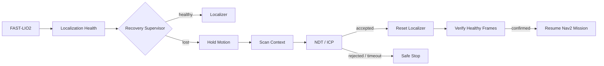

# Legged Navigation Runtime

[](https://github.com/zxinyu-robot/legged-navigation-runtime/actions/workflows/ci.yml)
[](https://isocpp.org/)
[](LICENSE)

面向双足和足式机器人的**故障恢复定位与多楼层导航运行时**。

本仓库是 Unitree G1/H2 级机器人导航工程的脱敏公开重构，聚焦定位前端失效后的安全恢复链路：

```text
定位失效
  ↓
暂停运动
  ↓
Scan Context 候选搜索
  ↓
NDT / ICP 精配准
  ↓
Localizer reset
  ↓
连续健康帧确认
  ↓
恢复 Nav2 任务
```

核心代码保持 **C++20、无 ROS 依赖、可单元测试**；ROS 2、Nav2 和厂商 SDK 通过适配层接入。

## What is included

| 能力 | 当前公开实现 |
| --- | --- |
| 故障恢复状态机 | `RelocalizationSupervisor`：Tracking、Searching、Aligning、Verifying、SafeStop |
| 恢复动作 | 暂停运动、候选搜索、精配准、Localizer reset、恢复任务、安全停车 |
| 配准结果门控 | 位姿跳变量与 alignment fitness 双阈值 |
| 超时保护 | 搜索/配准超时后进入 `SafeStop` |
| 恢复确认 | 连续健康帧通过后才恢复导航 |
| 延迟统计 | 固定容量窗口、nearest-rank P50/P95/最大值 |
| 平台配置 | G1/H2 独立配置示例 |
| 验证方式 | 回放 demo、单元测试、Linux/macOS CI |

## Quick start

要求：CMake 3.20+、Make、支持 C++20 的编译器。

```bash
cmake --preset default
cmake --build --preset default
ctest --preset default --output-on-failure
./build/default/recovery_demo
```

示例输出：

```text
relocalization replay
  t= 100 ms  tracking -> tracking  action=hold_motion
  t= 600 ms  tracking -> searching  action=search_candidate
  t= 800 ms  searching -> aligning  action=run_fine_alignment
  t=1100 ms  aligning -> verifying  action=reset_localizer
  t=1400 ms  verifying -> tracking  action=resume_navigation
synthetic latency window: samples=10 p50=17.2 ms p95=24.8 ms max=24.8 ms
```

演示中的延迟序列是合成数据，只用于验证统计代码。

## Recovery model



### State semantics

| 状态 | 语义 |
| --- | --- |
| `Tracking` | 正常定位和导航；单帧异常先保持运动安全，不立即重建定位 |
| `Searching` | 暂停导航，搜索全局描述子候选；超时进入 `SafeStop` |
| `Aligning` | 对候选执行 NDT/ICP；只有通过成功、位姿跳变和 fitness 门控才接受 |
| `Verifying` | 已 reset localizer，但继续暂停任务，等待连续健康帧 |
| `SafeStop` | 自动恢复耗尽或超时；需要显式 `reset()` 才能解除锁存 |

状态机不输出速度、关节力矩或足端指令，只输出可审计的恢复动作。底盘或全身控制器负责最终安全约束。

## Integration boundary

生产适配层需要连接以下接口：

- FAST-LIO2 或 localizer watchdog 的定位健康输入；
- Scan Context 全局候选服务；
- NDT/ICP 粗配准和精配准结果；
- localizer reset service 或 lifecycle transition；
- Nav2 任务暂停/恢复 action；
- 平台 safe-stop service。

ROS 2 集成应遵守：

- 统一使用 ROS time；
- 使用 request ID 拒绝过期响应；
- 将状态机更新放在互斥 callback group；
- 保持恢复动作与底盘安全层分离。

多楼层规划位于恢复运行时之上：

```text
拓扑规划器
  ↓
楼层 / 楼梯转换边
  ↓
SCAN-Planner / PCT-Planner 三维可通行段
  ↓
专用楼梯控制器
  ↓
楼层地图切换与任务继续
```

定位 reset 不能隐式改变语义楼层，也不能恢复已经过期的路径。

## Public implementation boundary

### Included

- `RelocalizationSupervisor`
- `RecoveryAction`
- 配准结果门控
- 搜索与配准超时保护
- 连续健康帧恢复确认
- 延迟窗口和统计
- 可运行回放 demo
- 单元测试与跨平台 CI

### Not included

- FAST-LIO2、Nav2、SCAN-Planner、PCT-Planner 第三方源码；
- 机器人厂商 SDK、控制器、实机地图和客户场景；
- 完整 ROS 2 节点；
- Scan Context、NDT、ICP 算法实现；
- 原项目中的多楼层地图、楼梯控制参数和 rosbag。

## Engineering results

以下结果来自对应的私有工程经历，不是当前仓库 CI 可复现的 benchmark：

| 指标 | 历史工程结果 |
| --- | --- |
| Scan Context + NDT/ICP 自动重定位 | 约 `1.0–1.2 s` |
| LOST 场景故障确认与恢复链路触发 | 约 `0.5 s` |
| G1 定位前端 P95 处理延迟 | 约 `25.9 ms` |
| H2 定位前端 P95 处理延迟 | 约 `16.3 ms` |

复现实测需要原始硬件、地图、rosbag 和完整 ROS 2 集成。指标口径见 [benchmark methodology](docs/benchmark-methodology.md)。

## Repository layout

```text
include/legged_navigation/
  relocalization_supervisor.h
  latency_window.h
src/
  relocalization_supervisor.cpp
  latency_window.cpp
  recovery_demo.cpp
tests/
  runtime_tests.cpp
config/
  g1.yaml
  h2.yaml
docs/
  system-design.md
  benchmark-methodology.md
```

## Next steps

1. 增加 ROS 2 lifecycle node 和诊断消息适配器。
2. 增加 Scan Context 候选与配准结果的录制回放接口。
3. 增加楼层拓扑任务模型和 Nav2 action 恢复适配器。
4. 在公开数据集上发布可复现的失效注入与延迟报告。

## License

[MIT](LICENSE)
