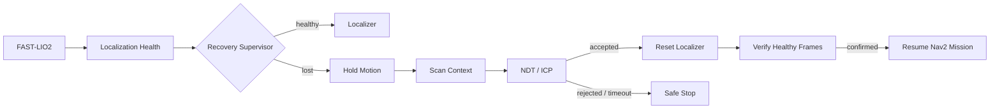

# Legged Navigation Runtime

[](https://github.com/zxinyu-robot/legged-navigation-runtime/actions/workflows/ci.yml)
[](https://isocpp.org/)
[](LICENSE)

Unitree G1/H2 双足机器人的端侧自主导航闭环，重点是定位失效后的自动恢复。

本仓库是 G1/H2 双足导航工程的脱敏公开重构。它与 [quadruped-crossfloor-nav-ws](https://github.com/zxinyu-robot/quadruped-crossfloor-nav-ws)（Unitree Go2 四足）是同一套端侧自主导航闭环在两类腿式平台上的实现：定位、规划、任务编排和安全执行都在机器人本机完成，不依赖云端或远程算力。本仓库公开的是其中的定位恢复部分。

> On-board autonomous navigation loop for Unitree G1/H2 bipeds, focused on recovery from localization failure. Sibling of [quadruped-crossfloor-nav-ws](https://github.com/zxinyu-robot/quadruped-crossfloor-nav-ws) (Unitree Go2 quadruped).

## 两个腿式平台的对应关系

| | 本仓库（双足） | quadruped-crossfloor-nav-ws（四足） |
|---|---|---|
| 平台 | Unitree G1 / H2 | Unitree Go2 + Livox Mid-360 |
| 端侧闭环 | `FAST-LIO2 → Localizer → Nav2（SCAN/PCT-Planner）→ 平台专用控制器` | `Super-LIO → PCT → SCAN → 行为树编排 → Sport API` |
| 开源集成 | FAST-LIO2、Nav2、SCAN-Planner、PCT-Planner | Super-LIO、PCT、SCAN |
| 自研 | 定位健康度判定、自动重定位与任务恢复状态机、延迟预算统计、平台配置 | 行为树编排、任务运行时、Forwarders、Sport API 适配 |
| 二者的连接 | `RecoveryPlugin` 提供恢复建议（不直接控制机器人） | 通过 `runtime/task_runtime` 的 `RecoveryPluginHost` / `RecoveryArbiter` 接入，执行权留在行为树一侧 |

本仓库的恢复状态机与 ROS 解耦，所以同一套恢复逻辑可以同时服务双足（本仓库的 G1/H2 配置）和四足（quadruped-crossfloor-nav-ws 中的 Go2）。

## 项目亮点

- 将定位健康度、自动重定位和任务恢复建模为确定性状态机，避免感知异常直接传播到运动控制。
- 面向 `FAST-LIO2 → Localizer → Nav2` 链路设计明确的故障边界和恢复动作。
- 支持 `Scan Context → NDT/ICP → Localizer reset` 的粗到精重定位流程。
- 提供固定容量 P50/P95/最大延迟统计，用于约束机器人端处理预算。
- 为 G1/H2 提供独立配置示例，平台差异放在配置里，恢复逻辑复用。
- 核心 C++20 代码无 ROS 依赖，可单元测试；ROS 2 集成放在适配层。
- `RecoveryPlugin` 的输入输出与 [ForkSpatial-Runtime-Engine](https://github.com/zxinyu-robot/ForkSpatial-Runtime-Engine) 的状态契约对齐，已接入 quadruped-crossfloor-nav-ws。

## 公开实现

当前仓库包含：

- `RelocalizationSupervisor`：Tracking、Searching、Aligning、Verifying、SafeStop 状态。
- `RecoveryPlugin`：对外的插件接口，只输出恢复建议（候选动作、授权建议、原因码），不持有执行权。
- `RecoveryAction`：暂停运动、候选搜索、精配准、Localizer 重置、恢复任务和安全停车。
- 配准结果门控：位姿跳变量与 fitness 双阈值。
- 搜索/配准超时保护和连续健康帧恢复确认。
- 滑动延迟窗口与 nearest-rank P50/P95 统计。
- 可运行的失效恢复回放、单元测试以及 Linux/macOS CI。

不公开或尚未实现的部分：

- FAST-LIO2、Nav2、SCAN-Planner、PCT-Planner 的第三方源码。
- 机器人厂商 SDK、控制器、实机地图、客户场景和 rosbag。
- 完整 ROS 2 节点、Scan Context/NDT/ICP 算法实现。
- 原项目中的多楼层地图和楼梯控制参数。

## 恢复链路



状态机不会输出速度指令，只输出可审计的恢复动作。底盘或全身控制器仍负责最终安全约束。

## 快速运行

要求：CMake 3.20+、Make、支持 C++20 的编译器。

```bash
cmake --preset default
cmake --build --preset default
ctest --preset default --output-on-failure
./build/default/recovery_demo
```

演示输出：

```text
relocalization replay
  t= 100 ms  tracking -> tracking  action=hold_motion
  t= 600 ms  tracking -> searching  action=search_candidate
  t= 800 ms  searching -> aligning  action=run_fine_alignment
  t=1100 ms  aligning -> verifying  action=reset_localizer
  t=1400 ms  verifying -> tracking  action=resume_navigation
synthetic latency window: samples=10 p50=17.2 ms p95=24.8 ms max=24.8 ms
```

演示中的延迟序列是合成数据，只用于验证统计代码。

## 工程案例结果

以下是 G1/H2 双足原工程中的实机结果，不是本仓库 CI 可以复现的 benchmark：

- Scan Context + NDT/ICP 自动重定位约 `1.0–1.2 s`。
- LOST 场景约 `0.5 s` 内确认定位丢失并触发恢复链路（对应配置项 `loss_confirmation_ms: 500`）。
- 通过最新帧消费、最近邻索引复用、地图缓存和 ROS 2 通信治理，将定位前端 P95 处理延迟优化至 G1 约 `25.9 ms`、H2 约 `16.3 ms`。
- 结合 SCAN-Planner、PCT-Planner、楼层地图、楼梯拓扑和专用控制器，形成平地、楼梯及跨楼层 3D 导航闭环。

复现实测结果需要原始硬件、地图、rosbag 与完整 ROS 2 集成；这些资产不包含在公开仓库中。指标口径见 [benchmark 方法](docs/benchmark-methodology.md)。

## 目录

```text
include/legged_navigation/
  relocalization_supervisor.h
  recovery_plugin.h
  latency_window.h
src/
  relocalization_supervisor.cpp
  recovery_plugin.cpp
  latency_window.cpp
  recovery_demo.cpp
tests/
  runtime_tests.cpp
  recovery_plugin_tests.cpp
config/
  g1.yaml
  h2.yaml
docs/
  system-design.md
  benchmark-methodology.md
```

## 下一步

1. 增加 ROS 2 lifecycle node 和诊断消息适配器。
2. 增加 Scan Context 候选与配准结果的录制回放接口。
3. 增加楼层拓扑任务模型和 Nav2 action 恢复适配器。
4. 在公开数据集上发布可复现的失效注入与延迟报告。

## License

[MIT](LICENSE)
